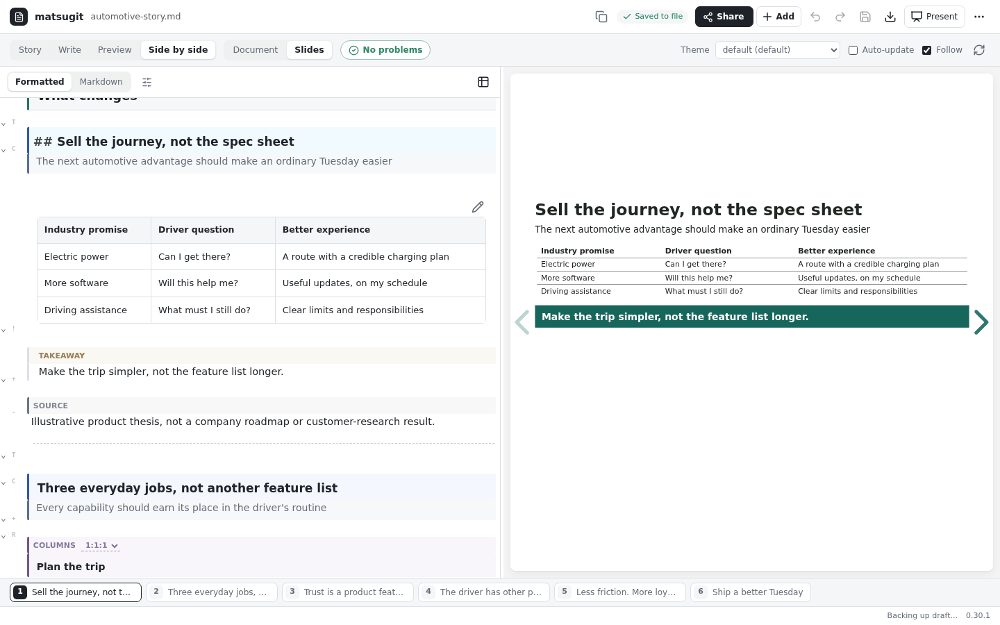
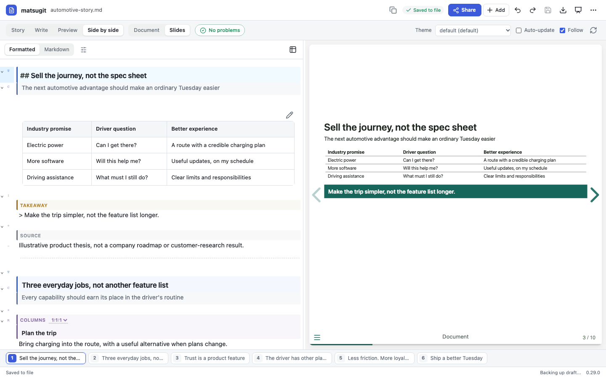
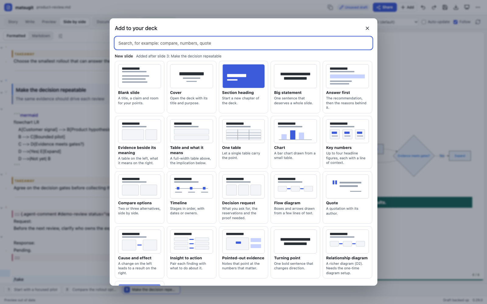
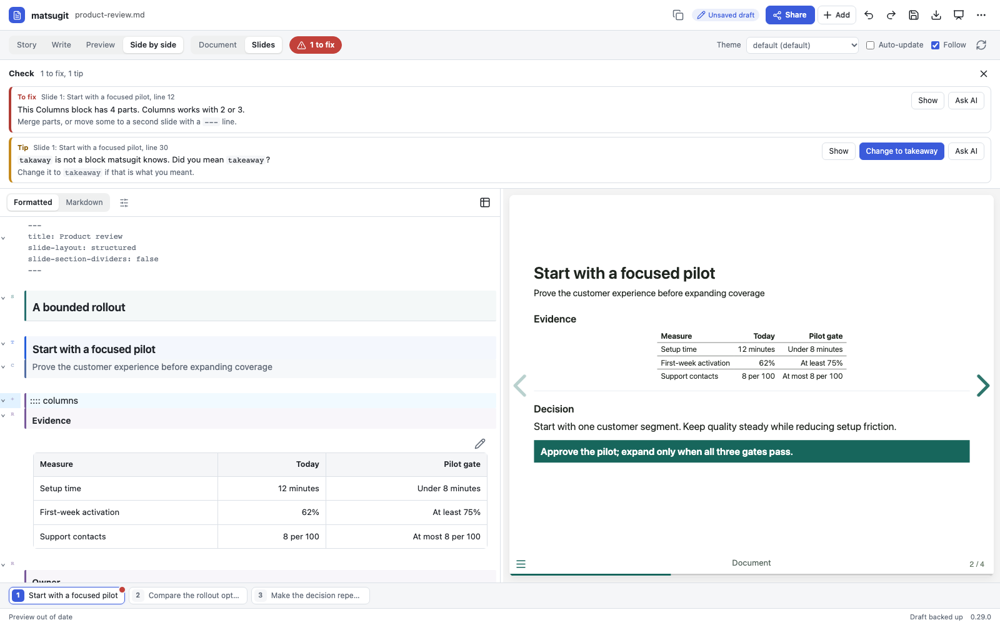
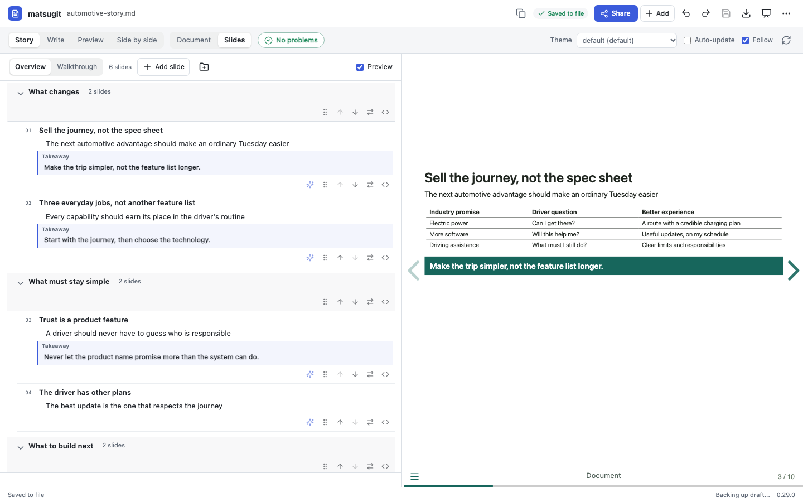
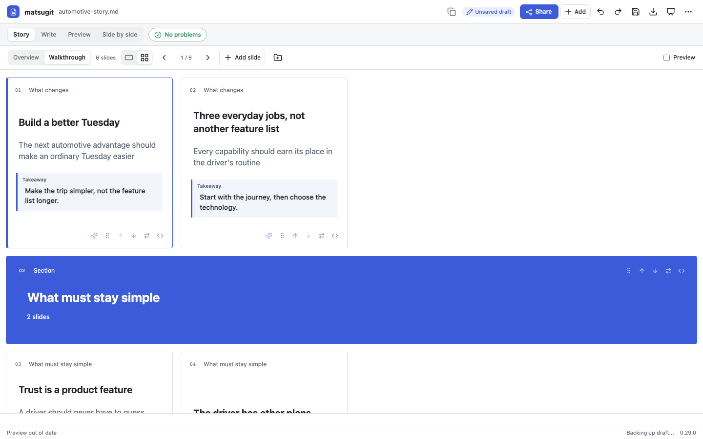
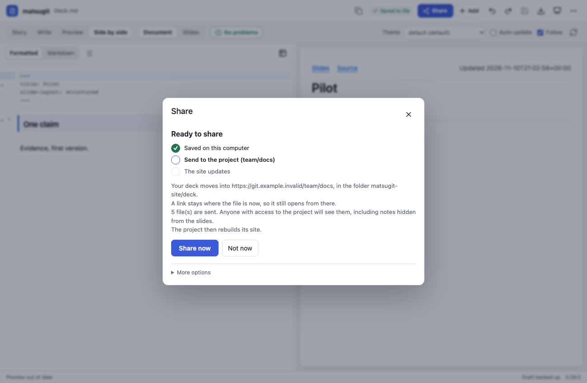

#+title: matsugit

*Your deck is a document. Write it like one.*

Ask your agent for a first draft, then edit the words yourself while the slides
keep up beside you. One Markdown file is the slides, the reading version and the
thing you share. No text boxes to nudge, no second copy drifting out of date.

/Recorded from the real workspace with the bundled theme and a
[[file:examples/automotive-story.md][synthetic example deck]]./

Created by [[https://github.com/guibor][MDF (guibor)]]. [[file:LICENSE][MIT licensed]]. Runs inside Cursor and Codex.

* Why people switch

- *You work on the argument, the theme does the formatting.* Titles, claims,
  evidence and takeaways are text. Layout, type and colour come from a theme, so
  slide forty looks like slide one.
- *The agent helps without holding the pen.* Let it draft, restructure or
  challenge a slide. Then change a number or rewrite a title yourself: that needs
  no AI call, and rendering uses no model tokens.
- *You and the agent can edit at the same time.* Changes on different lines
  combine by themselves. When you both touch the same sentence, you choose.
  Nothing you typed is overwritten.
- *One file, three outputs.* Slides to present, a document to read, and plain
  text that lives in Git. Export to PowerPoint or PDF when someone asks for one.
- *You do not need to know Markdown.* Pick layouts by picture, read problems in
  plain words, share with one button.

* What it looks like

** Edit like a document, watch the slide follow

Formatted text on the left, the real slide on the right. The strip along the
bottom is your deck: click a slide to go there, and a dot marks any slide that
needs attention. Double-click something on a slide to jump to that spot in the
text.

** Add a slide by picture

=Add= shows every layout as a thumbnail with a plain name: two columns, key
numbers, compare options, timeline, chart, quote. It puts the text in the right
place and selects what to type over.

** Always know what is wrong

=Check= says =No problems=, =2 to fix= or =1 tip=. Each item names the slide and
the line, explains the problem without jargon, and offers =Show=, a one-click
fix where one is safe, and =Ask AI=. If a mistake stops the preview, a banner
says why and the preview is marked as the last version that worked.

** Shape the story before the slides

=Story= lays out every title, claim and takeaway so you can read the argument
in order, rewrite a line, or drag a slide with all its content.
 shows the same thing as slide-shaped cards.

** Share with one button

=Share= puts the deck into your GitLab or GitHub project, sends later changes,
brings in a colleague's edits and tells you when the site is live. It shows its
three steps, asks once before anything leaves your computer, and never needs a
Git command.

* Start in two minutes

You need Node 22+, Python 3.10+, Git and [[https://quarto.org/docs/get-started/][Quarto]].

*Cursor.* From a checkout of this repository:
#+begin_src sh
matsugit setup-cursor
#+end_src
Enable the matsugit server in Cursor's MCP settings and start a new chat.

*Codex.*
#+begin_src sh
codex plugin marketplace add guibor/matsugit
codex plugin add matsugit@matsugit
#+end_src

Then, in a chat about your notes or an existing file:

| Say | What happens |
|-----+--------------|
| =/matsugit-new= (or "turn these notes into a deck") | The agent proposes one line per slide, waits for your edits, writes the file and opens it |
| =/matsugit-slides= (or "open deck.md in matsugit") | The workspace opens beside the chat on that file |
| =/matsugit-check= | You hear what is wrong, slide by slide, and can have it fixed |
| =/matsugit-story= | The narrative view opens for reordering |
| =/matsugit-help= | What to ask for and what each button does |

The workspace is opened by the agent, on a file, inside the chat. It is not a
separate app to launch. The slash commands are Cursor's; in Codex ask in words.
See the [[file:docs/cursor.md][Cursor guide]] and the [[file:docs/codex.org][workspace guide]] for setup details, including a
skill-only option with no server.

* A working session

1. *Draft.* Give the agent your notes. It writes one Markdown file.
2. *Edit.* Fix wording and numbers in the formatted view. The slide updates as
   you type.
3. *Build.* =Add= a comparison, a chart from a table, a timeline.
4. *Tighten.* Ask the agent to sharpen one slide (the sparkle icon in Story
   sends just that slide) while you keep working on another.
5. *Check.* Clear what =Check= lists.
6. *Arrange.* Reorder in =Story= until the argument reads in sequence.
7. *Present.* The screen icon presents; Escape returns to editing.
8. *Share.* One button, then a link.

Your file is saved when you press Save. Turn on =Save automatically= under the
=...= menu if you prefer; either way a file that changed elsewhere is never
overwritten, and a private recovery copy covers a crash.

* If you do write Markdown

It is ordinary Markdown with a few blocks for layout. Nothing is hidden: the
formatted view and the Markdown view are the same file.

#+begin_src markdown
---
title: Pilot decision
slide-layout: structured
---

# Recommendation
## Prove the process before expanding
### Speed must improve without increasing rework

:::: columns 2:1
#### Evidence
| Measure    | Baseline | Gate   |
| :---       | ---:     | ---:   |
| Cycle time | 12 days  | 8 days |

#### What it means
Expand only when both conditions are met.
::::

> [!TAKEAWAY]
> Approve a bounded pilot, not a full rollout.
#+end_src

=##= is a slide, =###= its claim, =####= a part of the slide. There are twelve
[[file:skills/matsugit/references/slide-types.md][slide recipes]], table-backed charts, Mermaid and D2 diagrams, speaker notes,
and themes you can write yourself. Org files work too. From the command line:

#+begin_src sh
python3 -m pip install .
matsugit template section --output deck.md
matsugit check deck.md
matsugit render deck.md --output /tmp/deck-preview
#+end_src

* What it is not

- Not a PowerPoint clone. You cannot drag a box to an arbitrary position; a
  theme decides placement. PowerPoint export is editable but approximate.
- Not a fact-checker. =Check= looks at slide structure, not at your numbers or
  how a slide looks. Look at the deck before you share it.
- Not a hosted service. Everything runs on your computer; sharing uses your own
  GitLab or GitHub project and your existing login.
- Share does not create a project or switch on its website for you, and it only
  says =Live= when your provider reports that version deployed.

* Guides

| For | Read |
|-----+------|
| The workspace: every control, saving, concurrent edits, Share, Check | [[file:docs/codex.org][Workspace guide]] |
| Cursor setup and commands | [[file:docs/cursor.md][Cursor guide]] |
| Syntax, with a "when something looks wrong" table | [[file:docs/syntax.md][Syntax cookbook]] |
| Choosing a slide by the argument it makes | [[file:skills/matsugit/references/slide-types.md][Slide recipes]] |
| Charts, diagrams, evidence callouts | [[file:docs/charts.md][Charts]], [[file:docs/diagrams.md][Diagrams]], [[file:docs/relationships.md][Evidence to action]] |
| Presenting, exporting, publishing | [[file:docs/delivery.org][Delivery]], [[file:docs/canonical-source.org][One source and Git]] |
| Themes | [[file:skills/matsugit/references/themes.md][Theme authoring]] |
| Org files, Emacs | [[file:docs/org.org][Org]], [[file:docs/emacs-story.org][Emacs Story]] |
| Everything else: CLI publishing, tables, renderer updates | [[file:docs/reference.org][Reference]] |
| Coming from Folioforge | [[file:docs/migration.org][Migration guide]] |
| How the code is organised | [[file:design.md][Design]], [[file:prd.org][Requirements]] |

* Development
#+begin_src sh
python3 -m unittest discover -s tests
QUARTO=/path/to/quarto python3 -m unittest discover -s tests
cd editor
npm ci --ignore-scripts
npm run build
#+end_src
Real renderer tests run when Quarto is available. Git publication tests use
temporary local bare remotes, never a live website or private document.
The browser bundle and dependency licenses are committed so consumers need no
Node toolchain. Commit the lockfile and generated assets together after changes.
Optional real-browser tests require Playwright and Chrome:
#+begin_src sh
MATSUGIT_BROWSER_TESTS=1 CHROME=/path/to/chrome python3 -m unittest discover -s tests -p test_editor_browser.py
#+end_src

* License and attribution

matsugit's original code and documentation are available under the
[[file:LICENSE][MIT License]], copyright MDF (guibor). Please link to the
[[https://github.com/guibor/matsugit][original project]] when sharing it; a visible credit is appreciated, not an
additional license requirement. Copies and substantial portions must retain
the copyright and license notice as specified in MIT.

Third-party components keep their own licenses. See the workspace's
[[file:codex-plugin/bundle/THIRD-PARTY-NOTICES.txt][dependency notices]], the table editor's
[[file:matsugit/editor_assets/THIRD-PARTY-LICENSES.txt][license notices]] and the bundled
[[file:matsugit/runtime/MATHJAX-LICENSE][MathJax license]]. Separately supplied private themes, logos and organization
assets are not licensed by this repository's MIT grant.
