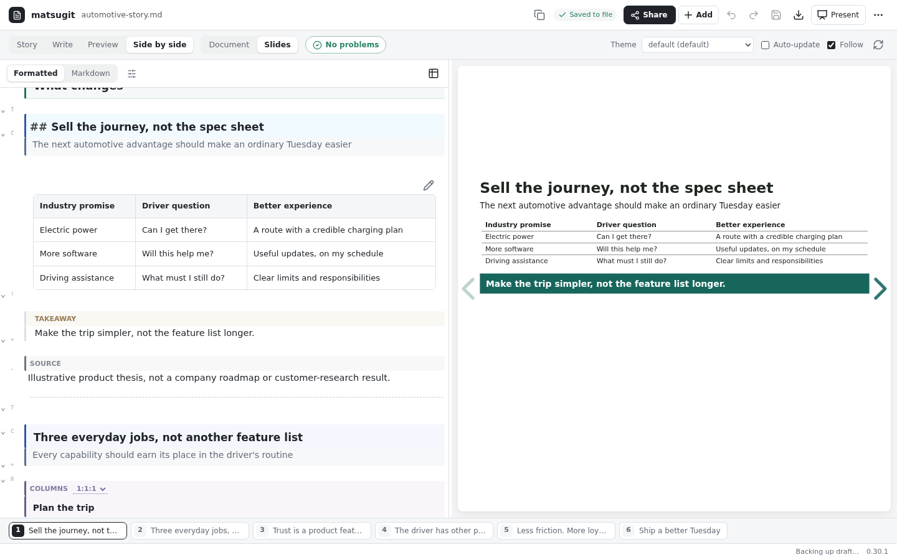
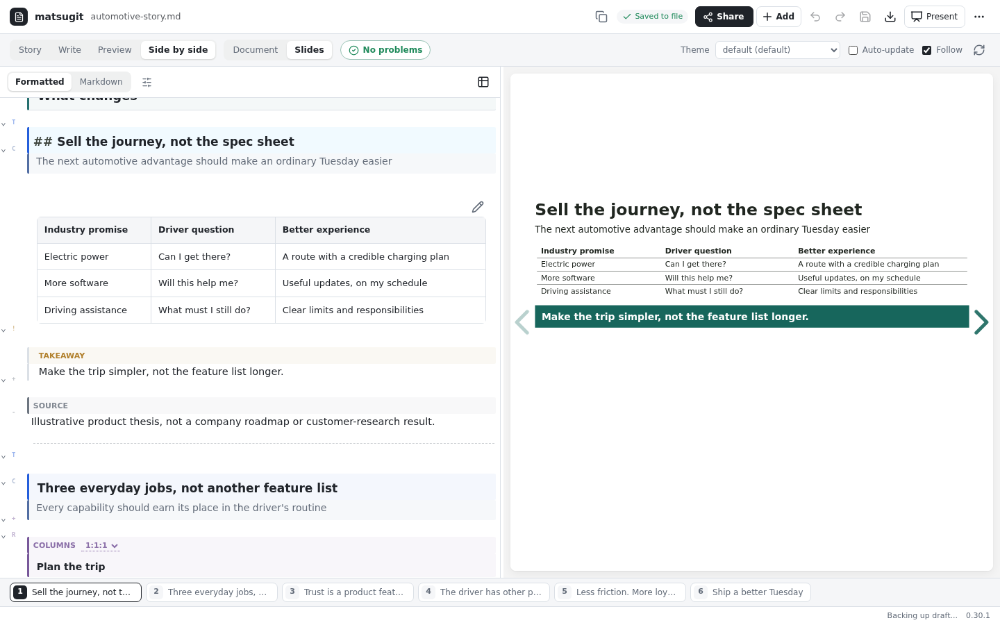
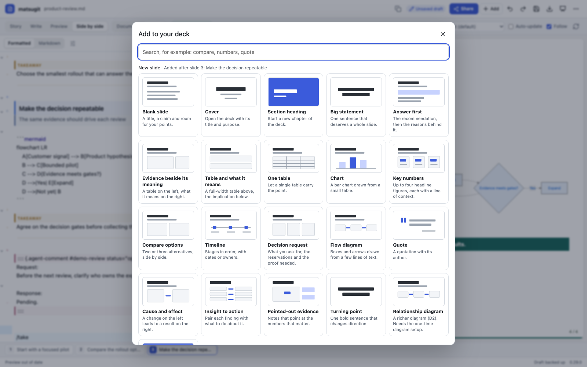
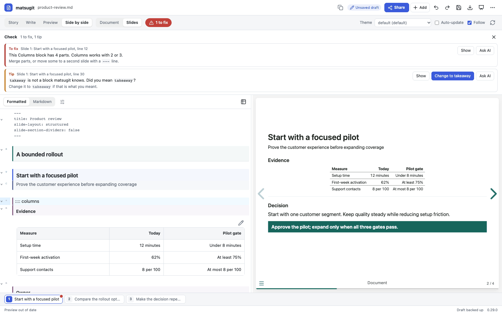
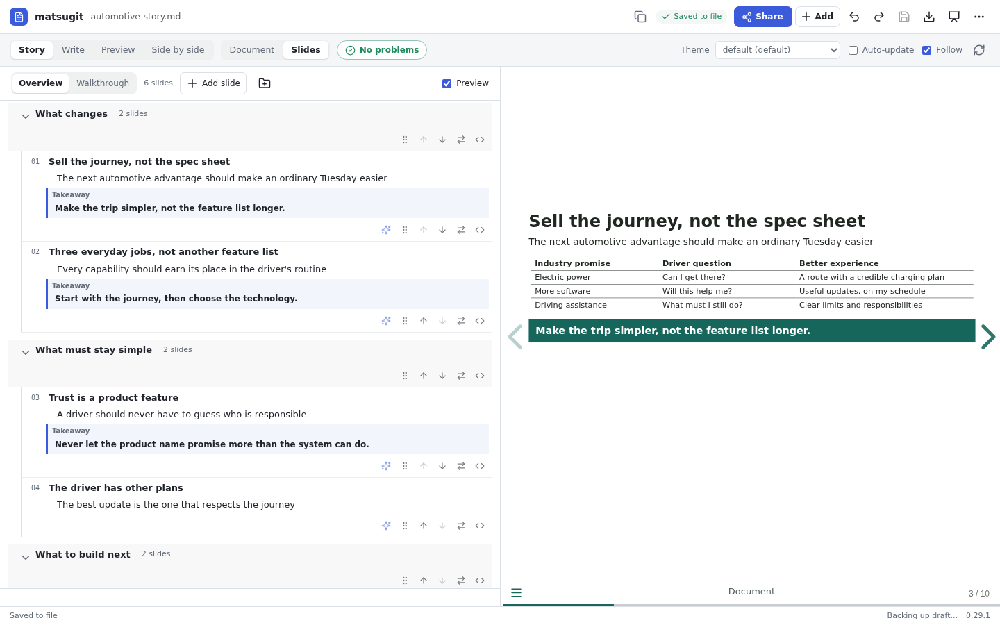
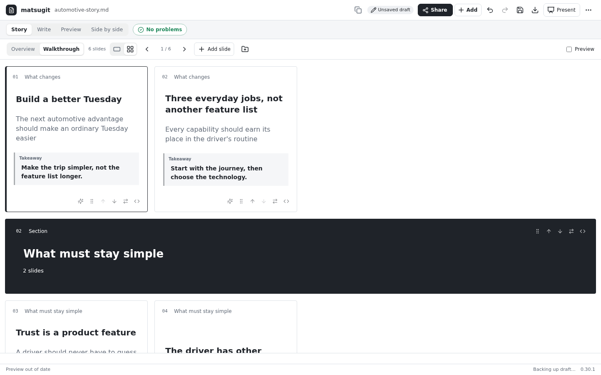
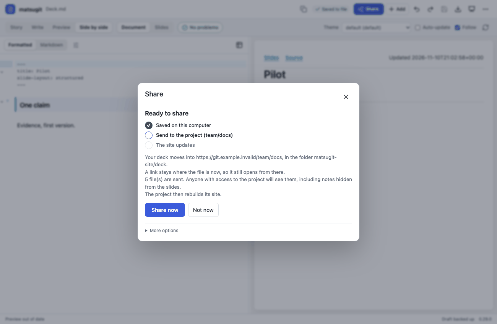

#+title: matsugit

*Your deck is a document. Write it like one.*

Ask your agent for a first draft, then edit the words yourself while the slides
keep up beside you. One Markdown file is the slides, the reading version and the
thing you share. No text boxes to nudge, no second copy drifting out of date.

/Recorded from the real workspace in an isolated test host, with the bundled
theme and a [[file:examples/automotive-story.md][synthetic example deck]]. Waiting time is shortened; this is not
a timing benchmark or a recording of native Cursor/Codex chrome./

Created by [[https://github.com/guibor][MDF (guibor)]]. [[file:LICENSE][MIT licensed]]. Runs inside Cursor, Codex and Claude.

* Why people switch

- *You work on the argument, the theme does the formatting.* Titles, claims,
  evidence and takeaways are text. Layout, type and colour come from a theme, so
  slide forty looks like slide one.
- *The agent helps without holding the pen.* Let it draft, restructure or
  challenge a slide. Then change a number or rewrite a title yourself: that needs
  no AI call, and rendering uses no model tokens.
- *You and the agent can edit at the same time.* Verified, independent agent
  edits combine with your draft automatically, with a notice and Undo. Your
  unsaved writing stays intact whether autosave is on or off. Other file
  updates wait for acceptance; overlaps and uncertain rewrites require review.
- *One file, three outputs.* Slides to present, a document to read, and plain
  text that lives in Git. Export to PowerPoint or PDF when someone asks for one.
- *You do not need to know Markdown.* Pick layouts by picture, read problems in
  plain words, share with one button.

* What it looks like

** Edit like a document, watch the slide follow

Formatted text on the left, the real slide on the right. The strip along the
bottom is your deck: click a slide to go there, and a dot marks any slide that
needs attention. Double-click something on a slide to jump to that spot in the
text.

To add to a column, click the empty space beside its words in the slide
preview. The editor places the caret at the end of that column; press Enter
after a bullet to add another. Clicking alone does not change the draft.

Prefer a full browser tab? Click the globe (=Open in browser=) in the toolbar.
It opens the same file in the browser editor. Unsaved writing prompts for
=Save and open= or =Cancel=; nothing is published.

** Add a slide by picture

=Add= shows every layout as a thumbnail with a plain name: two columns, key
numbers, compare options, timeline, chart, quote. It puts the text in the right
place and selects what to type over.

** Always know what is wrong

=Check draft= opens the checks; when there are findings, it shows a count
such as =2 to fix= or =1 tip=. Each item names the slide and
the line, explains the problem without jargon, and offers =Show=, a one-click
fix where one is safe, and =Ask AI=. If a mistake stops the preview, a banner
says why and the preview is marked as the last version that worked.

** Shape the story before the slides

=Story= lays out every title, claim and takeaway so you can read the argument
in order, rewrite a line, or drag a slide with all its content.
 shows the same thing as slide-shaped cards.

** Share with one button

=Share= puts the deck into your GitLab or GitHub project, sends later changes,
brings in a colleague's edits and tells you when the site is live. It shows its
three steps, asks once before anything leaves your computer, and never needs a
Git command.

* Get started

*VS Code.* From the Git checkout, run
=python3 vscode-extension/package_vscode.py --install= (Windows: =py -3= instead
of =python3=). Reload VS Code, open a Markdown or Org file, and run
=Matsugit: Open Document= in the Command Palette. The editor-title preview
button and =Reopen Editor With > Matsugit= also open the native editor tab.
This installs a separate VSIX, not the Codex/Cursor plugin ZIP. See
[[file:vscode-extension/README.md][VS Code installation and limits]].

Native Windows work is an opt-in [[file:docs/windows.md][compatibility preview]], not yet a
desktop-verified release. The existing Mac/Linux setup is unchanged.

You need Node 22+, Python 3.10+, Git and [[https://quarto.org/docs/get-started/][Quarto]].

*Cursor.* In a directory where you keep projects:
#+begin_src sh
git clone https://github.com/guibor/matsugit.git
cd matsugit
python3 -m matsugit setup-cursor
#+end_src
For an existing checkout, enter that directory and run the last command.
Enable the matsugit server in Cursor's MCP settings. Keep your existing chat;
start a new one only if the newly installed tools are not available there.

*Codex.*
#+begin_src sh
codex plugin marketplace add guibor/matsugit
codex plugin add matsugit@matsugit
#+end_src

*Claude Code.* In Claude Code:
#+begin_src text
/plugin marketplace add guibor/matsugit
/plugin install matsugit@matsugit
#+end_src
Claude Code has no panel beside the chat, so the workspace opens in your
browser instead, on its own, with the same split view and buttons. See the
[[file:docs/claude.md][Claude guide]].

*Claude Desktop.* It shows the panel in the conversation. From a checkout:
#+begin_src sh
python3 -m matsugit setup-claude-desktop
#+end_src
Then quit and reopen Claude Desktop.

The formatted editor needs Pandoc 3.7.0.2 or newer, which can be newer than the
copy bundled with Quarto. If setup reports it missing, run
=python3 -m matsugit setup-editor= from a checkout to install a verified,
isolated converter. This leaves system Pandoc unchanged.

Not sure what is missing? Choose =More > Check setup= in the workspace, ask your
agent to check matsugit setup, or run =python3 -m matsugit doctor= from the
checkout. The check reports required and optional tools separately. It does
not install software, open logins, publish documents or change settings.

** Your first minute

Start a new chat and type =/matsugit-tour= in Cursor or =/matsugit:matsugit-tour=
in Claude Code, or ask
Codex or Claude Desktop "Show me how matsugit works". A seven-slide sample opens
beside the chat (in Claude Code, in your browser), and the slides
themselves tell you what to try: change the first title and watch the slide,
press Add for a layout, open Story to see the whole argument. When you're
ready, type =/matsugit-new= with a line about what you need to present, or
paste your notes: your own draft opens in Story, ready to edit.

Then, in a chat about your notes or an existing file:

| Say | What happens |
|-----+--------------|
| =/matsugit-tour= (or "show me how matsugit works") | A short sample deck that explains itself opens beside the chat |
| =/matsugit-new= (or "turn these notes into a deck") | The agent drafts the deck straight away and opens it in Story, where you shape the storyline |
| =/matsugit-slides= (or "open deck.md in matsugit") | The workspace opens beside the chat on that file |
| =/matsugit-check= | You hear what is wrong, slide by slide, and can have it fixed |
| =/matsugit-story= | The narrative view opens for reordering |
| =/matsugit-help= | What to ask for and what each button does |

The workspace is opened by the agent, on a file, inside the chat. It is not a
separate app to launch. The table lists Cursor commands. Claude Code adds the
plugin namespace: =/matsugit:matsugit-new=, =/matsugit:matsugit-story=, and so on.
In Codex and Claude Desktop ask in words.

*No plugin, another agent, or nothing appears?* The same workspace opens in
your browser. The agent does this by itself when it has the skill, or run it
yourself from the checkout:
#+begin_src sh
python3 -m matsugit open deck.md     # no file: the sample deck
#+end_src
Everything works there, side by side, except that Ask AI copies the request
for you to paste into the chat. The agent can keep editing the file; the tab
takes its changes in. It runs on your computer only, behind a private address,
and stops five minutes after you close the tab.
See the [[file:docs/cursor.md][Cursor guide]] and the [[file:docs/codex.org][workspace guide]] for setup details, including a
skill-only option with no server.

* A working session

1. *Draft.* Give the agent your notes. It writes one Markdown file.
2. *Edit.* Fix wording and numbers in the formatted view. The slide updates as
   you type.
3. *Build.* =Add= a comparison, a chart from a table, a timeline.
4. *Tighten.* Ask the agent to sharpen one slide (the sparkle icon in Story
   sends just that slide) while you keep working on another.
5. *Check.* Clear what =Check= lists.
6. *Arrange.* Reorder in =Story= until the argument reads in sequence.
7. *Present.* The screen icon presents; =Exit presentation= or Escape returns
   to your previous view.
8. *Share.* One button, then a link.

Your file is saved when you press Save. Turn on =Save automatically= under the
=...= menu if you prefer. Saves check the file version and stop for review
when needed; local recovery copies can restore an interrupted draft. These
checks protect workspace saves, but cannot lock out an unrelated external editor.

=Changes= shows your draft, the saved/committed file, the last recorded push and
the last verified live version separately. Its local history includes source
checkpoints and recent Git commits. Compare slides, restore a document or choose
exactly which slide to restore. Restore changes only your draft, is undoable and
waits for explicit Save even when automatic saving is enabled. Images and themes
are not versioned by these source checkpoints. See [[file:docs/reliability.md][reliability and limits]].

* If you do write Markdown

It is ordinary Markdown with a few blocks for layout. Nothing is hidden: the
formatted view and the Markdown view are the same file.

#+begin_src markdown
---
title: Pilot decision
slide-layout: structured
---

# Recommendation
## Prove the process before expanding
### Speed must improve without increasing rework

:::: columns 2:1
#### Evidence
| Measure    | Baseline | Gate   |
| :---       | ---:     | ---:   |
| Cycle time | 12 days  | 8 days |

#### What it means
Expand only when both conditions are met.
::::

> [!TAKEAWAY]
> Approve a bounded pilot, not a full rollout.
#+end_src

=##= is a slide, =###= its claim, =####= a part of the slide. There are twelve
[[file:skills/matsugit/references/slide-types.md][slide recipes]], table-backed charts, Mermaid and D2 diagrams, speaker notes,
and themes you can write yourself. Org files work too. From the command line:

#+begin_src sh
python3 -m matsugit template section --output deck.md
python3 -m matsugit check deck.md
python3 -m matsugit render deck.md --output /tmp/deck-preview
python3 -m matsugit render deck.md --only document --output /tmp/reading-preview
python3 -m matsugit render deck.md --only slides --output /tmp/slides-preview
#+end_src

Run these from the checkout. With a separately installed CLI, the structural
check needs =matsugit check deck.md --checkout /path/to/matsugit=; =matsugit lint=
is the separate density check that does not need the Node workspace bundle.

The Markdown file is the source of truth. Reading HTML and slides are generated
views, never independent editable documents. Reading output keeps the wording,
flows columns vertically, and displays a claim as introductory text. It does not
invent prose. Notes stay excluded unless explicitly enabled for reading.

As a slide is displayed, =Check= measures its actual fit after fonts and media
load. =Content doesn't fit= means you should shorten it or choose a manual
=---= break; =Show= goes to its source. There is no automatic splitting,
summarising or font shrinking. Warnings do not block export: exporting without
fixing one may retain the layout problem. For a full-deck pass use
=matsugit lint deck.md --rendered /tmp/deck-preview= with the optional browser
dependencies. A hidden or not-yet-displayed slide is not certified by the
workspace's current-slide check.

* What it is not

- Not a PowerPoint clone. You cannot drag a box to an arbitrary position; a
  theme decides placement. PowerPoint export is editable but approximate.
- Not a fact-checker. =Check= looks at slide structure, not at your numbers or
  how a slide looks. Look at the deck before you share it.
- Not a hosted service. Everything runs on your computer; sharing uses your own
  GitLab or GitHub project and your existing login.
- Share does not create a project or switch on its website for you, and it only
  says =Live= when your provider reports that version deployed.

* Guides

| For | Read |
|-----+------|
| The workspace: every control, saving, concurrent edits, Share, Check | [[file:docs/codex.org][Workspace guide]] |
| Version-checked agent edits and setup diagnostics | [[file:docs/agent-editing.md][Scoped edits and setup checks]] |
| Cursor setup and commands | [[file:docs/cursor.md][Cursor guide]] |
| Claude Code and Claude Desktop | [[file:docs/claude.md][Claude guide]] |
| Syntax, with a "when something looks wrong" table | [[file:docs/syntax.md][Syntax cookbook]] |
| Choosing a slide by the argument it makes | [[file:skills/matsugit/references/slide-types.md][Slide recipes]] |
| Charts, diagrams, evidence callouts | [[file:docs/charts.md][Charts]], [[file:docs/diagrams.md][Diagrams]], [[file:docs/relationships.md][Evidence to action]] |
| Presenting, exporting, publishing | [[file:docs/delivery.org][Delivery]], [[file:docs/canonical-source.org][One source and Git]] |
| Themes | [[file:skills/matsugit/references/themes.md][Theme authoring]] |
| Org files, Emacs | [[file:docs/org.org][Org]], [[file:editors/emacs/README.org][Emacs package]], [[file:docs/emacs-story.org][Story controls]] |
| Everything else: CLI publishing, tables, renderer updates | [[file:docs/reference.org][Reference]] |
| Coming from Folioforge | [[file:docs/migration.org][Migration guide]] |
| How the code is organised | [[file:design.md][Design]], [[file:prd.org][Requirements]] |

* Development
#+begin_src sh
python3 -m unittest discover -s tests
QUARTO=/path/to/quarto python3 -m unittest discover -s tests
cd editor
npm ci --ignore-scripts
npm run build
#+end_src
Real renderer tests run when Quarto is available. Git publication tests use
temporary local bare remotes, never a live website or private document.
The browser bundle and dependency licenses are committed so consumers need no
Node toolchain. Commit the lockfile and generated assets together after changes.
Optional real-browser tests require Playwright and Chrome:
#+begin_src sh
MATSUGIT_BROWSER_TESTS=1 CHROME=/path/to/chrome python3 -m unittest discover -s tests -p test_editor_browser.py
#+end_src

* License and attribution

matsugit's original code and documentation are available under the
[[file:LICENSE][MIT License]], copyright MDF (guibor). Please link to the
[[https://github.com/guibor/matsugit][original project]] when sharing it; a visible credit is appreciated, not an
additional license requirement. Copies and substantial portions must retain
the copyright and license notice as specified in MIT.

Third-party components keep their own licenses. See the workspace's
[[file:codex-plugin/bundle/THIRD-PARTY-NOTICES.txt][dependency notices]], the table editor's
[[file:matsugit/editor_assets/THIRD-PARTY-LICENSES.txt][license notices]] and the bundled
[[file:matsugit/runtime/MATHJAX-LICENSE][MathJax license]]. Separately supplied private themes, logos and organization
assets are not licensed by this repository's MIT grant.
