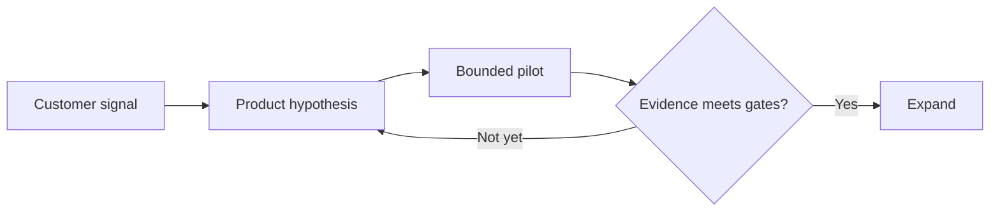

# A bounded rollout

## Start with a focused pilot
### Prove the customer experience before expanding coverage

:::: rows
#### Evidence
| Measure | Today | Pilot gate |
| :--- | ---: | ---: |
| Setup time | 12 minutes | Under 8 minutes |
| First-week activation | 62% | At least 75% |
| Support contacts | 8 per 100 | At most 8 per 100 |

#### Decision
Start with one customer segment. Keep quality steady while reducing setup friction.
::::

::: takeaway
Approve the pilot; expand only when all three gates pass.
:::

::: source
Illustrative product scenario. These are not company results.
:::

## Compare the rollout options
### A narrow pilot gives us a clear decision before a broad commitment

:::: comparison
#### Focused pilot
- One customer segment.
- Short feedback cycle.
- Explicit expansion gate.

#### Broad launch
- All segments together.
- More variation to interpret.
- Larger support commitment.
::::

::: takeaway
Choose the smallest rollout that can answer the key question.
:::

## Make the decision repeatable
### The same evidence should drive each review

::: takeaway
Agree on the decision gates before collecting the results.
:::

:::: {.agent-comment #demo-review status="open"}
Request:
Before the next review, clarify who owns the expansion decision.

Response:
Pending.
::::
