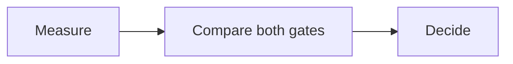

# A bounded pilot

## Prove the process before expanding
### Improve speed without increasing rework

:::: rows
#### Evidence
| Measure | Baseline | Pilot gate |
| :--- | ---: | ---: |
| Cycle time | 12 days | 8 days |
| Rework | 18% | At most 18% |
| Sample | 60 cases | 60 cases |

#### Interpretation
The two gates must be met together. These are illustrative values, not observed results.
::::

::: takeaway
Approve a bounded pilot, not a full rollout.
:::

## Make the decision repeatable
### Use the same evidence at each review

- Keep the source editable.
- Preserve the argument when the theme changes.
- Record the decision and its owner.
