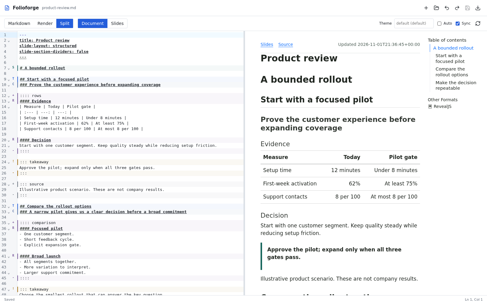
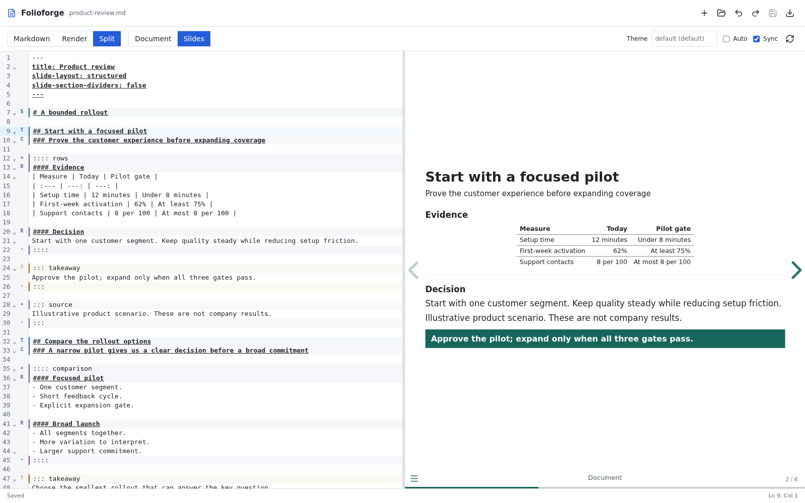
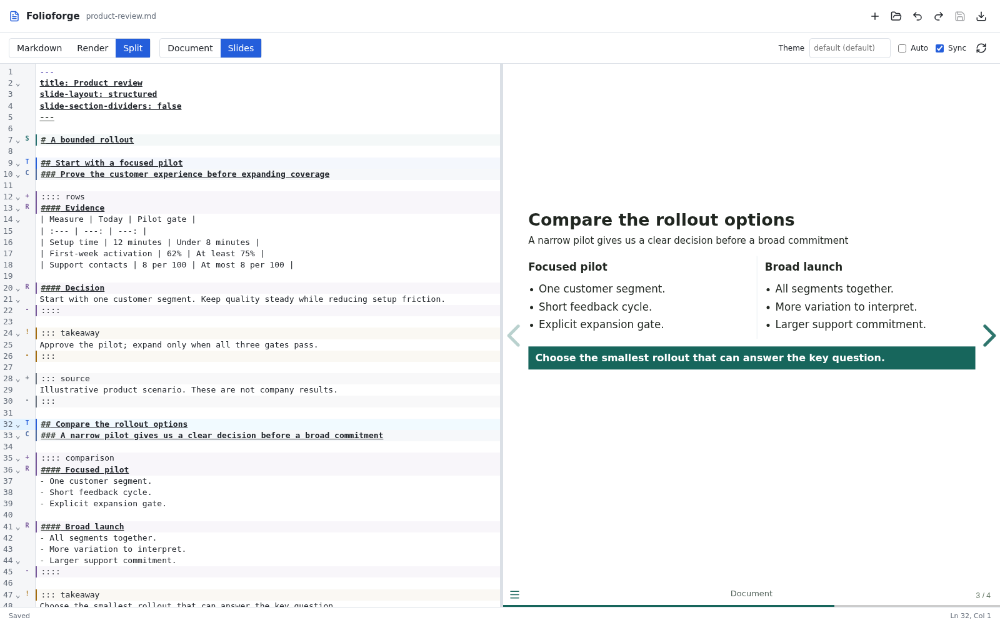
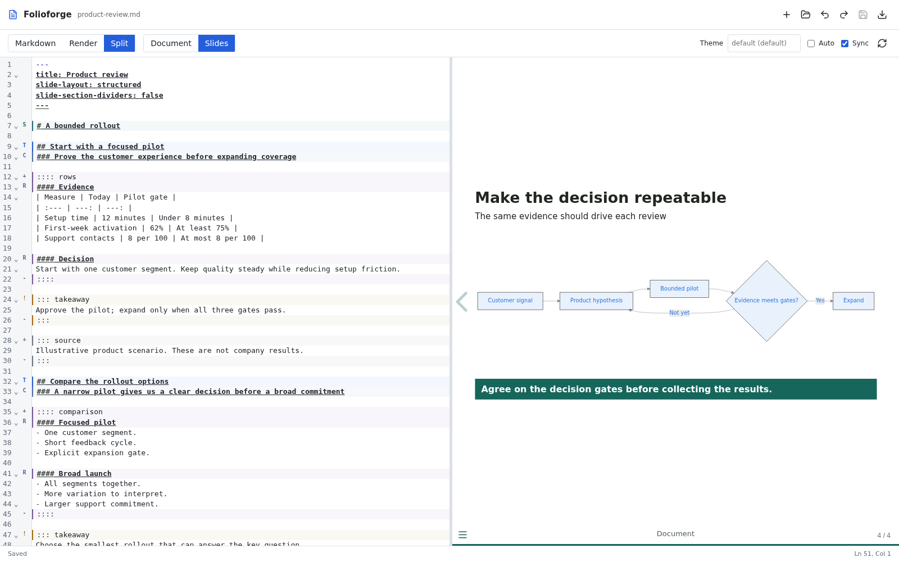
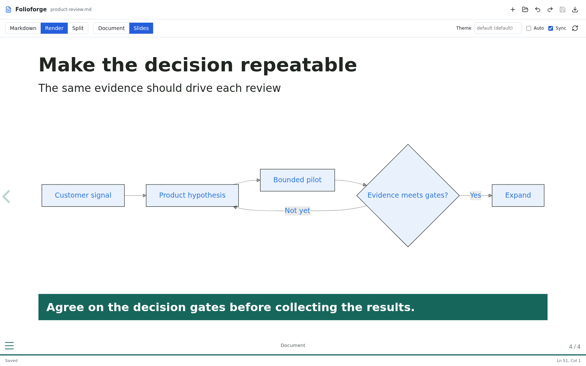
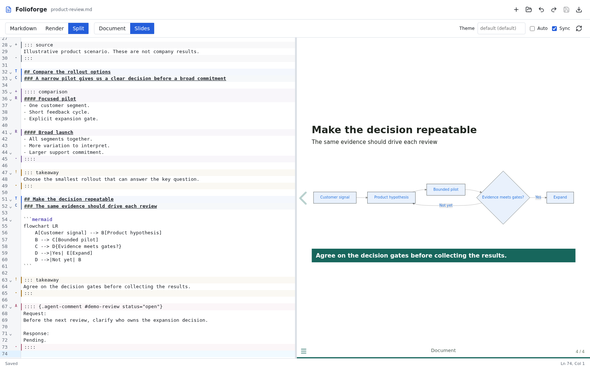
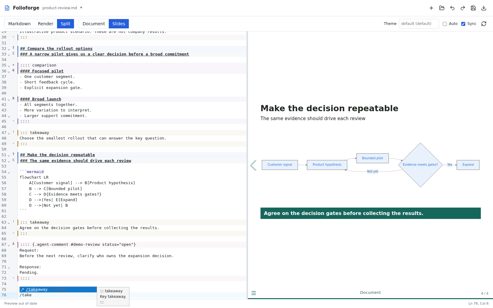

#+title: One product story, two useful outputs

Folioforge keeps a reading document and a presentation connected to the same
editable source. Ask the agent to organize an argument, review the evidence,
then edit the result directly. The theme supplies the layout; the source keeps
the meaning. Previewing and saving are separate from publication.

These are captures of the actual plugin UI in an isolated MCP test host, not
screenshots of the surrounding Codex desktop application. All figures and
scenarios are synthetic. No organization theme, private document or account is
included. The [[file:../codex-plugin/tests/product-review.md][example source]] is the same in every image.

* Read before presenting
Switch between a readable document and slides without maintaining two copies.
Split view keeps the source visible. Source-only and render-only views are
also available.

* Explain a decision with evidence
Keep the title, smaller claim, evidence and takeaway distinct. Tables remain
text in the source, rather than a screenshot that becomes stale.

* Compare options
A comparison block separates the alternatives. Changing a theme changes their
visual treatment, not their meaning or the Markdown structure.

* Describe a process
Mermaid turns a textual process into a diagram. The renderer fits media into
its slide region while retaining its aspect ratio. Diagram changes rebuild;
ordinary nearby text edits do not need to reload the unchanged diagram.

* Leave an agent a precise review request
Agent-comment blocks associate a stable request with a slide. The skill tells
the agent to preserve the request, respond with actual checks, and leave
acceptance to the author. They do not appear in the reading or slide output.
Hidden rendering is not confidentiality: source exports retain source text.

* Insert without memorizing the syntax
Type =/= on a blank line or open =+= to insert a recipe or semantic block.
The screenshot shows the takeaway menu; inserting remains an undoable source
edit, not a separate visual object.

* Try it
Follow [[file:codex.org][the installation guide]], then ask:

#+begin_quote
Use Folioforge to turn these notes into a decision brief and slides.
Keep the supplied numbers, flag missing evidence, and open the split slide
preview. Do not publish anything.
#+end_quote

Folioforge is not a native PowerPoint editor or a fact-checker. Save explicitly
before closing. The visual table editor is a separate Folioforge tool, not an
embedded spreadsheet in this workspace. Existing Git publication and optional
CI workflows remain separate from previewing in Codex.

* Reproduce these captures
With the plugin dependencies, Quarto, Python Playwright and Chromium installed:

#+begin_src sh
npm --prefix codex-plugin run build
python3 codex-plugin/tests/showcase.py --output /tmp/folioforge-showcase --theme default
#+end_src

Use a new output directory. =QUARTO= and
=PLAYWRIGHT_CHROMIUM_EXECUTABLE= can select existing runtime installations.
The script uses only the bundled synthetic fixture, checks browser errors,
and records capture provenance in =capture.json=. It never saves to a user's
document or publishes anything. Keep organization-branded captures outside
this repository.
