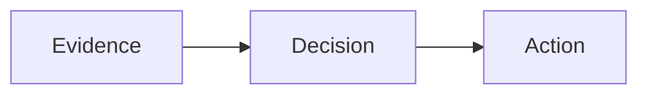

# Slide syntax cookbook

Write ordinary Markdown. Add layout blocks only where the arrangement matters.
The same source works with every theme; theme selection changes presentation,
not the meaning of headings or the available components.

For choosing a composition rather than a keyword, see the
[twelve slide recipes](../skills/matsugit/references/slide-types.md). The
[portable matsugit skill](../skills/matsugit/SKILL.md) also covers authoring,
theme creation and the distinction between supported and proposed capabilities.

## Start here

```markdown
---
title: Growth strategy
slide-layout: structured
slide-section-dividers: false
---

# Customer needs

## Expand beyond the highway
### Customers want one reliable product across more driving scenarios

- Highway remains essential.
- Urban driving creates the next opportunity.

::: takeaway
Prioritize reliability across scenarios before adding breadth.
:::
```

This creates a generated cover and one content slide. The YAML does not appear
as visible text in the reading document. `# Customer needs` labels the section;
with dividers disabled it does not create a separate divider slide.

| Syntax | Role in `structured` layout |
| --- | --- |
| YAML `title:` | Deck title and generated cover |
| YAML `subtitle:` | Subtitle on the generated cover, not every slide |
| `# Section` | Section; optional divider |
| `## Title` | New slide and its large title |
| `### Claim` | One smaller claim immediately below the slide title |
| `#### Heading` | Content-region heading within the slide |
| Standalone `---` | Explicit slide break |

Use H4, not another H3, for a second heading in the body. Text directly under an
H1 is preserved as a section-introduction slide even when dividers are disabled.

## How blocks work

`::: name` opens a block; another `:::` closes it. Leave blank lines around the
content. The colons disappear when rendered. For a block containing other blocks,
use more colons on the outside: for example `:::::` around `::::` around `:::`.
Backtick fences are different: they display code, or a Mermaid diagram.

`::: takeaway` and `::: {.takeaway}` both assign the `takeaway` class. Braces are
useful when adding options, as in `{.chart type="bar" unit="days"}`.

## Two or three columns

H4 headings define the columns. Widths are equal unless explicitly specified.

```markdown
:::: columns
#### Evidence
| Measure | Result |
| :--- | ---: |
| Baseline | 12 |
| Pilot | 8 |

#### Interpretation
- The pilot is faster.
- Quality must still be checked.
::::
```

For unequal widths, or columns without titles, use explicit column blocks:

```markdown
::::: columns
:::: {.column width="65%"}

::::

:::: {.column width="35%"}
The implication goes here. No heading is required.
::::
:::::
```

Do not mix explicit column blocks and H4-defined columns in one group. Each
column needs content. `columns` supports two or three columns, not arbitrary grids.

## Table above, interpretation below

Use `rows` for two or three vertically stacked regions. It is particularly useful
for separating a full-width table from the text that follows.

```markdown
:::: rows
#### Scorecard
| Measure | Baseline | Target |
| :--- | ---: | ---: |
| Duration | 12 days | 8 days |
| Rework | 18% | 18% |

#### What would change our decision
Expand only if speed improves without increasing rework.
::::
```

For untitled regions, use explicit nested `::: row` blocks instead of H4
headings, just as with columns. Rows provide separation, not guaranteed 50/50
height or automatic pagination. Keep the content within a slide's reading capacity.

## Semantic components

These use the same H4-region pattern but give the regions a meaning:

| Block | Regions | Use it for |
| --- | --- | --- |
| `metrics` | 1-4 | Key figures, with explanations |
| `comparison` | 2-3 | Alternatives, before/after, tradeoffs |
| `timeline` | 2-6 | Ordered stages, dates, owners |
| `decision` | 2-4 | Recommendation, reservations, proof gates |

```markdown
:::: comparison
#### Standardize first
Lower initial cost; easier to revise as we learn.

#### Automate first
More scale potential; greater integration risk.
::::

::: takeaway
Automate a proven process, not an unresolved one.
:::
```

A metric is authored text, not a calculation. Put its value in bold:

```markdown
:::: metrics
#### Cycle time
**8 days**

Pilot target; baseline is 12 days.

#### Investment
**$60k cap**

Includes implementation and measurement.
::::
```

For `timeline`, write one H4 per stage and its details below. For `decision`,
write one H4 per decision region. The renderer does not invent labels, dates,
owners, recommendations or numbers.

## Claims, takeaways, sources and notes

```markdown
::: assertion
Buy evidence before buying scale.
:::

::: takeaway
Approve the pilot, not the rollout.
:::

::: source
Internal pilot scorecard, October 2026. Illustrative example.
:::

::: notes
Ask the committee to name an accountable sponsor.
:::
```

`assertion` is a prominent statement in the body. `takeaway` is one separate
bottom conclusion per slide. `source` is optional supporting attribution. It is
omitted from documents and slides unless YAML explicitly contains
`publish-sources: true` (default: `false`). Org uses `#+PUBLISH_SOURCES: true`.
This is structural filtering, not CSS hiding: ordinary links, footnotes,
headings named Sources, code examples and quote `attribution` blocks remain.
The original source is never edited; explicit source downloads retain your draft.
`notes` is presenter
content, included in the optional handout; review it before sharing exports.

The slide claim normally uses H3. An explicit `::: claim` block is also supported
as an alternative. Do not use both for the same slide. Nothing generates or
summarizes these words for you.

## Charts from editable data

```markdown
:::: {.chart type="bar" unit="days" highlight="Pilot" caption="Illustrative duration"}
| Cohort | Duration |
| :--- | ---: |
| Baseline | 12 |
| Pilot | 8 |
::::
```

Use `bar`, `barh`, `line` or `scatter`. The first column contains labels (numeric
X values for scatter); the next one to four columns contain numeric series.
Units are required. Keep units out of numeric cells. Up to 30 rows are supported;
missing values are rejected, not silently replaced by zero. `highlight` names
a category to emphasize. Line-chart categories are equally spaced, not a continuous
time axis. Install the optional backend once with `matsugit setup-charts`.

## Images and Mermaid

Ordinary Markdown works. A full-slide image fits the available body; an image
inside a column fits that column. The default preserves aspect ratio without cropping.

```markdown

```

For a half-width image aligned left:

```markdown
{.media-half .media-left}
```

`.media-right` aligns right; `.media-cover` explicitly permits cropping. Avoid
cropping charts or screenshots whose labels matter. `.media-natural` opts out of
automatic slide fitting when an image should retain its natural treatment.

````markdown

````

Mermaid can also sit inside a column. Theme colors and media fitting are applied
by the renderer. Diagrams and tables are not split automatically across slides.

## Continue or start a new slide

```markdown
## Rollout plan
### Validate each stage before expanding

First group of evidence.

---

Second group of evidence, with the same title and claim.

## A different slide title
### A different claim

New content.
```

Use blank lines before and after `---`, otherwise Markdown may treat it as an
underline-style heading. A break repeats the current title and claim; a new H3
immediately after the break can replace the claim. Use H2 to change the title.

## Optional slide roles

```markdown
---
title: Reference study
slide-layout: structured
slide-section-dividers: false
slide-empty-slides: true
slide-title-page: false
slide-aspect-ratio: "4:3"
---

## Reference study {.cover}
### October 2026

{.media-natural}

## One statement worth a whole slide {.statement}

## {.image-slide}


```

`.cover` is an authored cover, `.statement` is a statement-only slide, and
`.image-slide` hides the heading. `slide-empty-slides: true` retains heading-only
slides. `slide-title-page: false` prevents a duplicate generated cover without
removing the reading-document title. The aspect ratio defaults to `"16:9"`;
`"4:3"` is opt-in, not a theme restriction.

For dense evidence, wrap a table in `::: compact` (tighter rows) or
`::: data-table` (dense financial-table treatment). Wrap a long quotation in
`::: quotation`. `.dense` on a slide heading deliberately tightens its body.
These are explicit choices, not automatic shrinking or permission to overload a slide.

### Quote slides

Use `/quote` (also `/quotation`) for a dedicated quotation slide:

```markdown
## The decision principle {.quote .hide-title .hide-claim}
### An optional explanation kept in the storyline

> Your authorized quotation goes here.

::: attribution
-- Author, role or publication
:::
```

The quote is centered with a large opening quotation mark and a smaller author
line beneath. Attribution is visible content, not a `source` block subject to
source-publication settings. Ordinary blockquotes and `::: quotation` excerpts
keep their document/evidence styling. Do not invent quotations or attribution.

Remove `.hide-title` or `.hide-claim` to display that heading on the slide. These
classes also work on other slide types; the headings remain in the Markdown,
storyline and reading document. Org retains them as `:CUSTOM_CLASS:` properties.
Use `slide-layout: structured` for the standard H2 title / H3 claim hierarchy.

## When something looks wrong

In the Codex or Cursor workspace, open `Check` (beside Document/Slides). It
names the slide and line, explains the problem in plain words and can fix the
common ones. The mistakes it catches most often:

| What you see | Cause | Fix |
| --- | --- | --- |
| `:::` printed on the slide | The block's first line is glued to the text above it | Leave an empty line before `::: name` |
| Later slides vanish into one slide | A block is missing its closing `:::` line | Add the closing line where the block ends |
| A line turned into a big heading | `---` sits directly under text | Leave an empty line before `---` |
| `##Title` shown as text | No space after the `#` signs | Write `## Title` |
| Columns are stacked, not side by side | `slide-layout: structured` is missing from the settings at the top | Add it |
| The preview stops updating | The renderer refused a slide, for example four columns or two claims | Read `Check`; the preview shows the last version that worked |
| A slide is missing | It has only a title | Add content, or set `slide-empty-slides: true` |

From a terminal, `matsugit check deck.md` prints the same findings.
Agents can run the same check with the `matsugit_check` tool. It checks
structure only; still look at the slides.

## Emacs and CLI

- `M-x mdf/matsugit-insert-template` / `SPC m e v i`: insert a starter.
- `M-x mdf/matsugit-select-theme` / `SPC m e v t`: change this buffer's style.
- `M-x mdf/matsugit-preview-slides` / `SPC m e v s`: preview without publishing.
- `M-x mdf/matsugit-preview-document` / `SPC m e v d`: reading preview.
- `M-x mdf/matsugit-lint` / `SPC m e v l`: structural checks.

CLI starters: `matsugit template comparison --output comparison.md`.
Other template names are `metrics`, `timeline`, `decision`, `assertion`, `chart`
and `section`. Templates refuse to overwrite existing files.

Prefer `structured` for new decks. `title-claim` is a different, older mapping
that turns parent headings into titles and child headings into claims; do not
mix its heading assumptions with this cookbook. `default` retains the ordinary
renderer layout instead of opting into the fixed H1/H2/H3 structure.
