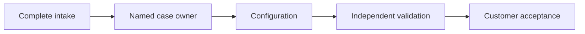

# Recommendation

## Approve a six-week pilot before committing to rollout
### Standardise intake, prove the benefit and cap the downside

:::: decision
#### Recommendation
Fund a **$60k pilot** for one customer segment.

#### Reservations
The baseline is observational. The expected improvement is a hypothesis, not a measured treatment effect.

#### Proof gate
Expand only after cycle time improves without higher rework or customer complaints.
::::

::: takeaway
The decision is a controlled test, not a full operating-model change.
:::

::: notes
Audience: operating committee. Decision: approve a capped pilot. All organisations, observations and financial assumptions in this deck are fictional. This is an original consulting-style demonstration, not a BCG presentation.
:::

## Intake is the largest controllable source of delay
### Two weeks of baseline observations suggest where to test first

:::: {.chart type="barh" unit="days per onboarding" highlight="Intake" caption="Median stage duration, illustrative baseline"}
| Stage | Days |
| :--- | ---: |
| Intake | 5 |
| Configuration | 3 |
| Validation | 2 |
| Handover | 2 |
::::

::: source
Synthetic baseline: 100 cases. Stage medians are illustrative; their sum is not an estimate of the overall median.
:::

## A four-day reduction is the target, not an established result

:::: metrics
#### Cycle time
**8 days**

Pilot target; baseline is 12 days.

#### Rework
**At most 18%**

Do not exceed the baseline rate.

#### Investment
**$60k cap**

Includes delivery and measurement.
::::

::: source
Synthetic assumptions, set before the pilot. Outcomes are not yet measured.
:::

## Standardisation tests the mechanism at lower cost than automation

:::: comparison
#### Standardise first
- One intake schema and clear ownership.
- Fast to change when evidence contradicts the design.
- Requires continued human judgement.

#### Automate first
- Potential scale benefit after the process stabilises.
- Higher initial cost and integration risk.
- Could encode today's avoidable variation.
::::

::: takeaway
Automate a proven process, not an unresolved one.
:::

## A single owner makes handoffs explicit

::: source
Proposed pilot process. Arrows show responsibility transitions, not measured elapsed time.
:::

## Savings depend on adoption, not just a faster best case
### An illustrative sensitivity makes the commercial threshold explicit

:::: {.chart type="line" unit="annual benefit, USD thousands" caption="1200 annual cases; $200 saved per adopted case"}
| Adoption | Annual benefit |
| :--- | ---: |
| 25% | 60 |
| 50% | 120 |
| 75% | 180 |
| 100% | 240 |
::::

::: source
Synthetic model: 1200 cases x adoption x $200. Gross benefit before recurring costs; not a forecast.
:::

## Separate the scorecard from the decision it supports

:::: rows
#### Evidence to collect
| Measure | Baseline | Pilot gate |
| :--- | ---: | :--- |
| Median cycle time | 12 days | At most 8 days |
| Rework rate | 18% | No increase |
| Customer complaints | 4 per 100 | No increase |

#### Decision rule
Pass all three gates before scaling. A faster process with poorer quality is not a successful pilot.
::::

## Run the pilot in three stages with accountable owners

:::: timeline
#### Weeks 1-2
Freeze definitions and recruit comparable cases.

**Owner:** operations lead.

#### Weeks 3-6
Run the new intake flow and log exceptions.

**Owner:** delivery lead.

#### Week 7
Review results, uncertainty and full recurring cost.

**Owner:** operating committee.
::::

## Stop early if the intervention creates customer harm

:::: columns
#### Guardrails
- Review every serious complaint immediately.
- Keep an owner for exceptional cases.
- Retain the existing flow as a reversible fallback.

#### Measurement discipline
- Define exclusions before looking at results.
- Report variation and sample size, not just averages.
- Separate operational learning from causal claims.
::::

## Approve the cap and name the accountable sponsor

::: assertion
Spend $60k to buy evidence before buying scale.
:::

::: takeaway
Sponsor: COO. Decision: authorise the pilot and the week-seven review.
:::

::: notes
If the committee rejects the investment, preserve the baseline and document which assumption needs stronger evidence. Do not quietly substitute a rollout for the approved pilot.
:::
