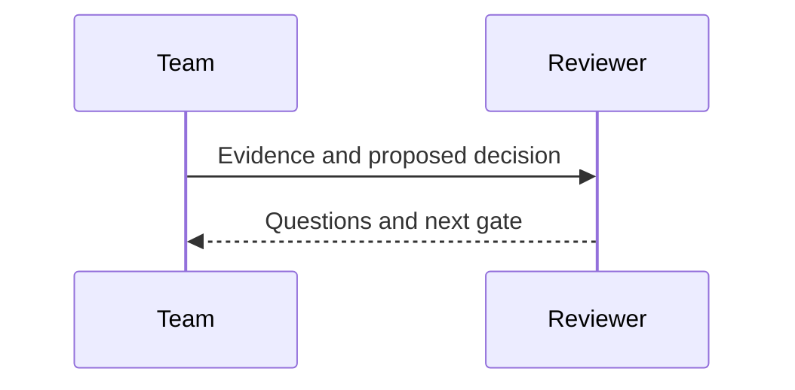

# Evidence to action

## One source, a clear decision
### Relationships stay editable; the theme owns their appearance

```d2
direction: right
evidence: Customer evidence
insight: Unmet need
decision: Product decision
evidence -> insight: reveals
insight -> decision: informs
```

::: takeaway
Describe the relationship, not the coordinates.
:::

## Keep the system boundaries visible
### Containers explain who owns each part of the process

```d2
direction: right
discovery: Discovery {
  interviews: Interviews
  observations: Observations
}
delivery: Delivery {
  pilot: Bounded pilot
  review: Outcome review
  pilot -> review: measures
}
discovery.interviews -> delivery.pilot: informs
discovery.observations -> delivery.pilot: validates
delivery.review -> discovery.interviews: new questions
```

## A diagram can share a slide
### Use ordinary columns to keep the interpretation beside the evidence

:::: columns 2:1
#### Mechanism
```d2
direction: down
signal: Evidence
test: Test a hypothesis
decision: Review results
signal -> test -> decision
```

#### Interpretation
- State the hypothesis before testing.
- Agree on evidence that would change the decision.
- Review the remaining uncertainty.
::::

## Mermaid remains available
### Choose the notation that expresses the relationship most clearly


