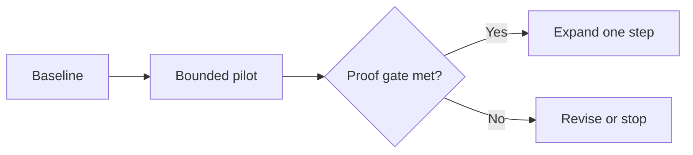

## Pilot decision brief {.cover}
### An illustrative investment in learning

Decision committee | October 2026

## Buy evidence before buying scale {.statement}

## Make the next investment reversible
### A measured pilot is more useful than a premature rollout

::: assertion
Prove the process before expanding it.
:::

- Define the baseline before intervention.
- Measure speed and quality together.
- Stop if the proof gate is not met.

## Set a balanced scorecard
### Improvement must not trade quality for speed

:::: metrics
#### Cycle time
**8 days**

Pilot target; baseline is 12.

#### Rework
**18% maximum**

Do not exceed the baseline.

#### Investment
**60k cap**

Illustrative budget units.
::::

::: source
Synthetic planning assumptions, October 2026; not measured results.
:::

## The pilot targets a shorter cycle
### The target is four days below the baseline

:::: {.chart type="bar" unit="days" highlight="Pilot target" caption="Illustrative cycle-time target"}
| Cohort | Duration |
| :--- | ---: |
| Baseline | 12 |
| Pilot target | 8 |
::::

::: source
Synthetic planning values, October 2026; not a causal estimate.
:::

## Faster is useful only with stable quality
### The comparison is a decision input, not proof of success

::::: columns
:::: {.column width="65%"}
::: {.chart type="barh" unit="days" caption="Illustrative target, not an observed result"}
| Cohort | Duration |
| :--- | ---: |
| Baseline | 12 |
| Pilot target | 8 |
:::
::::

:::: {.column width="35%"}
#### Interpretation
- Validate the target against actual cases.
- Check rework before expanding.
::::
:::::

::: source
Synthetic planning values, October 2026.
:::

## Use both measures at the proof gate
### The table and its implication are separate regions

:::: rows
#### Scorecard
| Measure | Baseline | Gate |
| :--- | ---: | ---: |
| Median cycle time | 12 days | At most 8 days |
| Rework share | 18% | At most 18% |

#### Implication
Expand only when both conditions are met in the agreed sample.
::::

::: takeaway
A speed-only improvement is insufficient.
:::

## Compare two ways to learn
### Keep the evaluation criteria consistent

:::: comparison
#### Standardize first
- Lower initial commitment.
- More manual measurement.

#### Automate first
- Higher integration effort.
- Less reversible implementation.
::::

::: takeaway
Prefer the smallest change that can test the hypothesis.
:::

## Make the operating logic explicit
### Evidence should determine the next action

## Sequence work around gates
### Each stage has an accountable role

:::: timeline
#### Weeks 1-2
Operations records the baseline.

#### Weeks 3-6
Product runs the bounded pilot.

#### Week 7
Sponsor reviews the proof gate.
::::

## Preserve the decision rule
### Documentary evidence should retain its exact meaning

::: quotation
> Expansion requires both a shorter cycle and no increase in rework.
:::

::: source
Original synthetic policy example written for this demonstration.
:::

## Approve a pilot, not a rollout
### Limit the commitment until the evidence is available

:::: decision
#### Request
Approve the bounded pilot.

#### Condition
Keep the illustrative budget cap.

#### Accountability
The sponsor reviews the week-seven gate.
::::

::: takeaway
Authorize learning now; decide on scale after measurement.
:::

::: notes
These are synthetic examples. Replace assumptions with approved evidence.
:::
