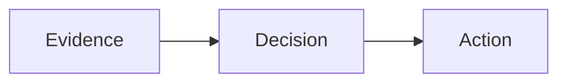

# Authoring contract

## Source structure

```markdown
---
title: Decision brief
slide-layout: structured
slide-section-dividers: false
---

# Recommendation
## Test before expanding
### A bounded pilot can resolve the main uncertainty

- Supporting evidence, not an unsupported promise.

::: takeaway
Approve the pilot, not the rollout.
:::
```

YAML stays in editable source but is not shown as document text. H1 can create a
divider when `slide-section-dividers: true`; text below an H1 is still retained
when dividers are off. H2 starts a slide. One H3 immediately after it is the
smaller claim, not another slide. Use H4 for body headings. `::: claim` is an
alternative to H3, not an additional claim. One `takeaway` per slide is optional.

A standalone `---` with blank lines around it continues the current title and
claim on another slide. A new H2 changes the title. Do not use `---` as a
decorative line within a slide. Keep frontmatter at the start of the file.

`slide-title-page: false` suppresses the generated cover. An authored cover uses
`## Deck title {.cover}`. Heading-only `.statement` slides require
`slide-empty-slides: true`. `slide-aspect-ratio: "4:3"` is explicit; default is
`"16:9"`. These are display options, not executable Quarto configuration.

## Composition

Use longer colon fences for outer containers. In a group, choose H4-delimited
regions OR explicit child blocks, not a mixture:

```markdown
::::: columns
:::: {.column width="65%"}
#### Evidence
| Measure | Before | After |
| :--- | ---: | ---: |
| Days | 12 | 8 |
::::

:::: {.column width="35%"}
#### Implication
Validate quality before expanding.
::::
:::::
```

`columns` and `rows` allow two or three regions. Explicit children are `column`
or `row`; omit a heading for an untitled region. Rows separate a table from its
interpretation without promising equal height. Nest columns inside a row when
necessary; avoid deeply nested layouts. Keep the slide claim and takeaway
outside the body-region container.

| Block | Bound | Meaning |
| --- | --- | --- |
| `metrics` | 1-4 H4 regions | Values with scope and comparison; bold the main value |
| `comparison` | 2-3 H4 regions | Alternatives evaluated against matching criteria |
| `timeline` | 2-6 H4 regions | Ordered stages, dates, gates and owners |
| `decision` | 2-4 H4 regions | Request, reservations, proof gates or accountability |
| `assertion` | One body statement | Emphasis inside a slide |
| `source` | Authored text/links | Visible attribution, period and scope |
| `notes` | Authored text | Presenter guidance; not a secrecy boundary |

Semantic components are not numerical models. Metrics, totals, timelines and
recommendations are authored, not computed. Cite the evidence supporting them.

## Evidence

```markdown
:::: {.chart type="barh" unit="days" highlight="Pilot" caption="Illustrative cycle time"}
| Cohort | Duration |
| :--- | ---: |
| Baseline | 12 |
| Pilot | 8 |
::::

::: source
Synthetic example. Replace with observed data and its period.
:::
```

Charts support `bar`, `barh`, `line`, `scatter`, `stacked`, `stacked100`; one label column plus 1-4 numeric
series, at most 30 data rows. Units are required, numeric cells omit suffixes,
missing values fail rather than become zero. Scatter requires numeric X labels;
line categories are equally spaced, not a continuous date axis. `highlight`
must name a category; the current visual highlight applies to single-series
bar/barh charts, not arbitrary annotations. Provision the optional backend with
`folioforge setup-charts` only when installation is authorized. Otherwise use an
existing Altair/vl-convert environment or explain the dependency. Matplotlib is
the explicit legacy backend, not the preferred engine.

For richer exhibits use a `vega-lite` JSON fence with inline data, usually
prepared with Altair in a separate reviewed script. Standard Vega-Lite handles
temporal axes, layers, rules, ranges, heatmaps and waterfall calculations. Do not
invent a chart DSL, manually draw chart geometry or execute document Python.
Specifications are schema-validated and exported to SVG with editable `.vl.json`
assets. Remote data, image marks, hyperlinks, interactive parameters,
expression-valued properties and facet/concat/repeat are refused; compose with
Markdown columns/rows instead. Limits: 1 MB, 5000 items per array, 40 levels,
60 seconds per chart. Slot dimensions override spec dimensions, retaining
logical font sizes in columns. Validate labels and arithmetic in the preview.

Takeaways are conclusions, not sources or notes: write a short implication in
`::: takeaway`. Shared themes render a high-contrast conclusion band. Never
invent a takeaway that the supplied evidence or reference does not support.

Mermaid fences render diagrams without executing general document code:

````markdown

````

Images use ordinary `` syntax. Keep local
assets inside the source Git project. `.media-half`, `.media-left`, `.media-right`
control placement; `.media-natural` opts out of fitting; `.media-cover` permits
cropping explicitly. Use a surrounding div for diagram attributes. Do not crop
chart labels or screenshots. A `.image-slide` hides its heading, not its data.

Use pipe tables for ordinary cells; Pandoc grid tables for merged/multiline
cells, not a sidecar. Grid tables need the appropriate Pandoc reader and will
not look merged in GitHub GFM. `folioforge edit-table` takes exactly one table
and a new output file. `.compact` tightens padding; `.data-table` and slide role
`.dense` are deliberate dense treatments, not a general overflow remedy.

## Validation and compatibility

Read titles and claims as a standalone argument, then reconcile the numbers.
Render into a new directory and check every slide, not only the cover. Verify
source order, evidence readability, no overlap, intact media, and a usable
reading version. Match fonts to what recipients and CI actually have.

The shared syntax works across themes, but renderers can differ: Folioforge's
generic path scrolls crowded content rather than paginating it. A separately
managed organization renderer may have automatic continuation slides and tighter
claim limits. Use that project's documented renderer for final acceptance; a
generic preview does not prove CI parity. Do not replace such a renderer merely
to follow this skill. Keep unsupported exhibits as attributed local images or
report the missing native capability. Do not pretend a roadmap is a dated Gantt
chart, or a categorical line plot a correctly spaced time series.
