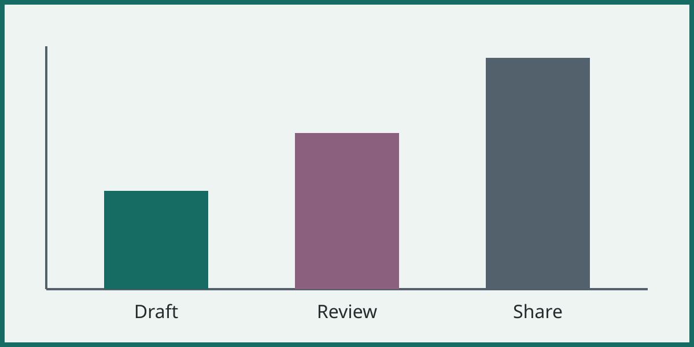
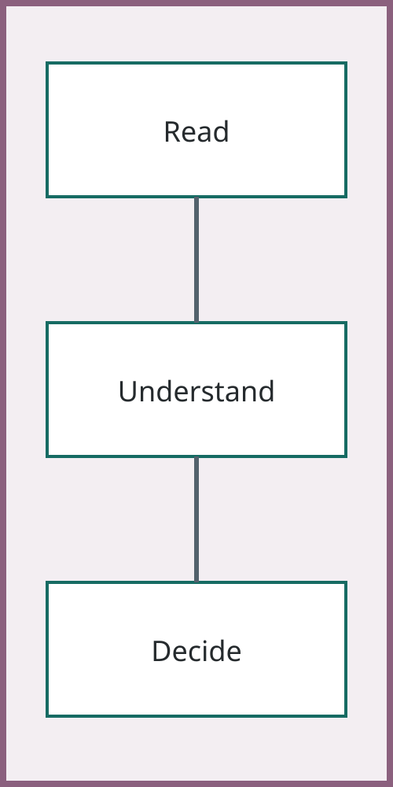

## Two images share a comparison

:::: comparison
#### Landscape

#### Portrait

::::

::: takeaway
Both exhibits retain their aspect ratio and fit the same slide.
:::

## An uncaptioned portrait still fits

::: source
Synthetic test image.
:::
