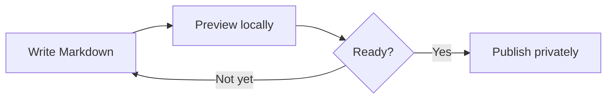
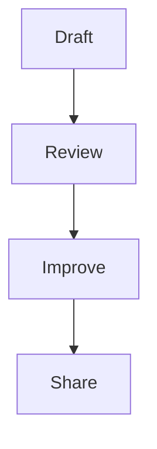
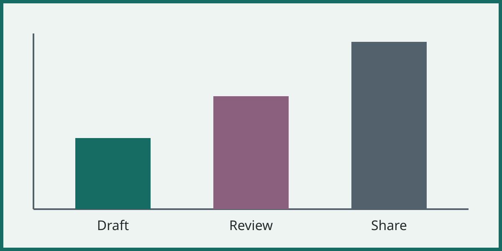
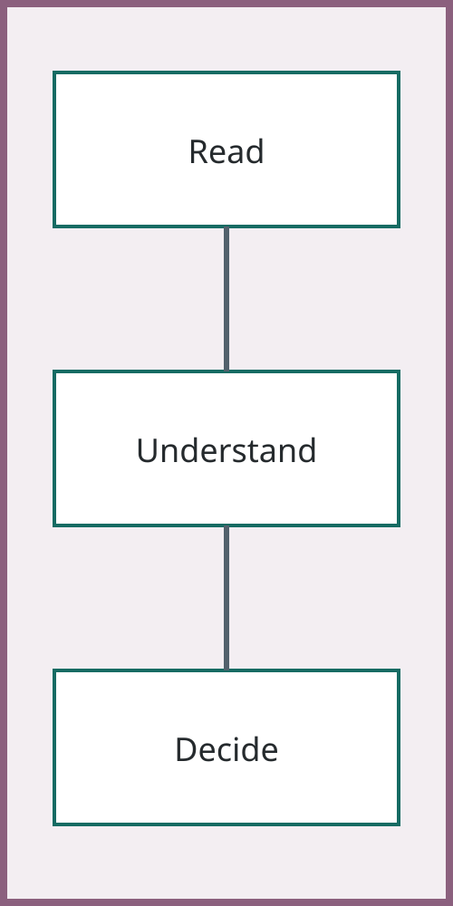

## A full-width diagram



## Diagram and explanation

### Each column gets the space it needs

:::: {.columns}
::: {.column width="50%"}

:::
::: {.column width="50%"}
- The diagram fits the left half.
- This text keeps its normal size.
- The takeaway has its own space.
:::
::::

::: takeaway
Fit the visual to its container, without cropping the information.
:::

## Compare two images

:::: {.columns}
::: {.column width="50%"}

:::
::: {.column width="50%"}

:::
::::

## A portrait with supporting text

### Even a long supporting heading leaves enough space for the image and its caption


::: takeaway
No cropping is applied by default.
:::

## A sequence diagram

```{mermaid}
sequenceDiagram
  participant A as Writer
  participant B as Renderer
  participant C as Reader
  A->>B: Markdown source
  B->>C: Document and slides
  C-->>A: Feedback
```

## A deliberately smaller visual

{.media-half}

## Ordinary code stays code

```python
raise RuntimeError("Do not execute document code")
```
