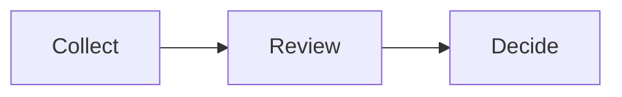

## Automatic separation

### A table and a following explanation remain distinct

| Input | Value |
| :--- | ---: |
| Sample | 30 |
| Change | 12% |

#### An explanation after the table

The explanation belongs below the exhibit, not to its final row.

::: takeaway
Separate content without interpreting the numbers.
:::

## Explicit stacked sections

### Authors decide which content belongs together

:::: rows
::: row
| Input | Value |
| :--- | ---: |
| Sample | 30 |
| Change | 12% |
:::

::: row
#### A worked example

- The upper section contains the assumptions.
- The lower section contains the explanation.
:::
::::

::: takeaway
No title is required for either section.
:::

## A diagram above an explanation

### Media must respect both sections and the takeaway

:::: rows
#### Process

#### Interpretation

- Test the result before expanding.
- Preserve labels, proportions and readable text.
::::

::: takeaway
Content is never cropped to force equal halves.
:::
