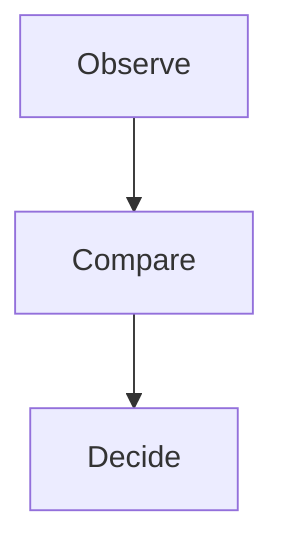

# Decisions

## Keep the headline distinct from the explanation

### A smaller, lighter claim should leave enough space for the evidence that supports it

:::: columns
#### Evidence

| Measure | Baseline | Pilot |
| :--- | ---: | ---: |
| Completion | 62% | 81% |
| Rework | 18% | 9% |
| Response | 4 days | 2 days |

#### Process

::::

::: takeaway
Make the conclusion easy to find without making everything equally loud.
:::

## Tables deserve enough room to compare the evidence

### Alignment, spacing and restrained emphasis help the reader scan accurately

| Approach | Strength | Limitation |
| :--- | :--- | :--- |
| Small pilot | Quick feedback | Narrow sample |
| Phased rollout | Broader evidence | Takes longer |
| Full rollout | Immediate reach | Harder to reverse |

::: takeaway
Choose the next step using the evidence, not the amount of content on the slide.
:::

---

#### A deliberate continuation

- The same title and claim remain visible.
- A manual separator creates a new slide without a blank page.
- The previous takeaway stays with its own slide.

## An unfinished outline heading
